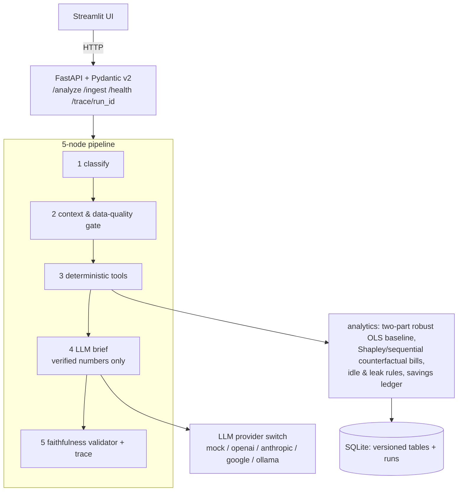

# Factory Energy Cost Decomposition and Savings Agent

A hackathon system that explains why a factory's electricity bill changed — splitting
the change into **tariff, production volume, product mix, weather and unexplained
waste** (the five parts add up to the observed change *exactly*), then detects
controllable waste from meter evidence, and recommends actions with **kWh / money /
CO2e savings ranges, payback and ease**. The LLM only writes prose over numbers that
verified tools computed; every run is fully traceable.

## Architecture



**The decomposition method** (25 pts of the rubric): counterfactual bill simulation
with exact per-interval price lookups (so a mid-period tariff change is handled
precisely, R4) + **Shapley attribution** over {tariff, volume, mix, weather}.
`explained = Σ φ_f` exactly; `waste = observed change − explained` — so the five
causes reconcile **by construction** and are verified by tests/eval. The baseline is
a robust two-part model: base load from off-production intervals (nights/weekends/
holidays), production surplus on per-product unit volumes + degree-days + calendar,
fitted on the baseline quarter only. Uncertainty: weekly block bootstrap
(model refit per draw) → 10–90% bands per cause. Config B (sequential, order-documented)
is retained and measured for comparison.

## Quickstart

```bash
cp .env.example .env          # choose LLM_PROVIDER/LLM_MODEL (keys stay in .env, never git)
docker compose up --build     # api on :8000, ui on :8501, data volume ./data
# or locally:
pip install -r requirements.txt
uvicorn src.api.main:app --port 8000 &
streamlit run src/ui/app.py   # port 8501
```

Load data (committed reproducible synthetic pack, or judge-provided CSVs in the Annex
B schema):

```bash
python -m src.ingest.cli load-pack --dir data/synthetic
python -m src.ingest.cli status
```

### Sample curl commands

```bash
curl -s localhost:8000/health | jq
curl -s -X POST localhost:8000/analyze -H 'Content-Type: application/json' \
     -d '{"question": "Why did the bill go up this quarter compared with last quarter?",
          "period": "2026-Q3", "compare_to": "2026-Q2"}' | jq
curl -s localhost:8000/trace/en-5d20ab | jq
curl -s -X POST localhost:8000/ingest -F 'file=@data/synthetic/tariff.csv' \
     -F 'meta={"table": "tariff"}' | jq        # late data drop: new version, old kept
```

Answer types: `decomposition | recommendation | calculated | not_in_data |
clarification_needed | refused`. The system computes its own bill change and reports
it even when the question quotes a different figure ("up 15%"); the "15%" is never
treated as fact.

## Tests & evaluation

```bash
pytest tests/ -q                       # 42 unit + integration tests
python evaluation/runner.py --dataset synthetic --config A
python evaluation/runner.py --dataset synthetic --config B
python evaluation/runner.py --dataset no_leak   --config A
python evaluation/runner.py --dataset no_leak   --config B
python evaluation/report.py            # -> evaluation/reports/eval_report.md
```

The committed evaluation set has **22 cases over two datasets** (with and without the
injected waste pattern; all four dataset×config runs pass). Ground truths are the
generator's injected parameters and independent recomputations
(`evaluation/truth.py`) — no hidden answer key is used or guessed.

## Late data drop playbook (13:45)

1. Judges upload corrected files → `POST /ingest` (schema + quality checks; rejected
   files never take over). Each version is tracked (`data_versions`: sha256, rows).
2. Re-run the same question. `/analyze` resolves the ACTIVE versions per run and
   stamps fingerprints into the trace; decomposition recomputes — no stale caches.
3. Compare the two run ids (UI screen "Late-drop compare" or `GET /trace/{run_id}`)
   → what changed and why; both runs remain auditable.

## LLM

Configured via `.env` (never committed): this build runs **LLM_PROVIDER=google,
LLM_MODEL=gemini-3.1-flash-lite** (the spec's flash tier; higher-tier flash models
returned quota-limited responses with this key — the provider switch makes that a
one-line change). Keys stay in `.env`; the provider retries with backoff on 429/5xx
and the workflow falls back to the deterministic template brief if the API is
unavailable — a live demo cannot fail on the LLM. `MOCK_LLM=true` runs everything
without network.

## Assumptions & limitations (also disclosed per-run in the brief)

* Counterfactuals are level translations on the current period's calendar (standard
  index decomposition; quarters have different dates).
* Daily energy is allocated to tariff buckets with the baseline quarter's observed
  intraday shares (profile-shape stability).
* The `waste` term includes baseline model error + estimation noise — it is a RANGE
  and only supports an asset-level claim when corroborated by idle/meter evidence.
  "Consistent with a compressed-air leak" is an inferred cause, labelled as such.
* Implementation cost ranges and reduction fractions are documented assumptions
  (savings module); emission factor must come from the data card/config or the
  CO2e field is omitted and the dependency flagged.
* Known edge cases handled on purpose (see validation script output in the UI):
  cumulative meters + resets, missing intervals (+30 min interpolation policy),
  duplicates, sub-meter coverage ~96.5% of main (disclosed, not rescaled), tariff
  change mid-quarter, mislabeled public holidays, mix shifts.

## Repo map

```
src/api        FastAPI app (4 endpoints)
src/graph      LangGraph nodes + workflow + engine (tool dispatch)
src/analytics  billing, baseline, decomposition, assets, idle, savings, whatif, ops_calendar
src/ingest     Annex-B adapter loader + versioning + CLI loader
src/validate   the six mandated checks (+ holiday-as-shift, data card conformance)
src/llm        provider switch, prompt, number-faithfulness validator
src/ui         Streamlit (renders only verified values)
src/store      SQLite schema, run/trace store, version registry
scripts        generate_synthetic.py (seeded), late_drop_drill.py, export_traces.py
evaluation     cases.yaml, runner.py, truth.py, report.py, reports/
tests          unit + integration (API/graph incl. late drop roundtrip)
docs           data card, architecture, AI-usage disclosure, contribution statement
```

Full methodology: `docs/architecture.md` · Data card: `data/synthetic/data_card.json`
and `docs/data_card.md` · Evaluation: `evaluation/reports/eval_report.md`.
